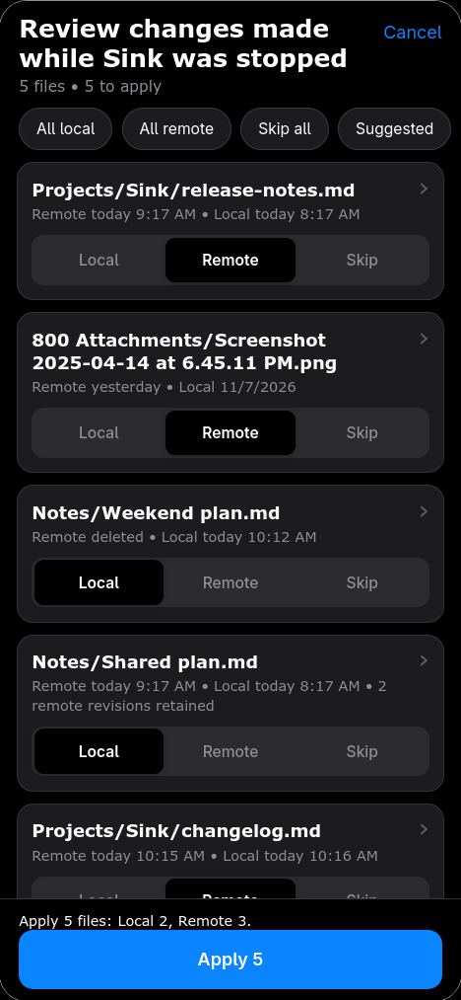
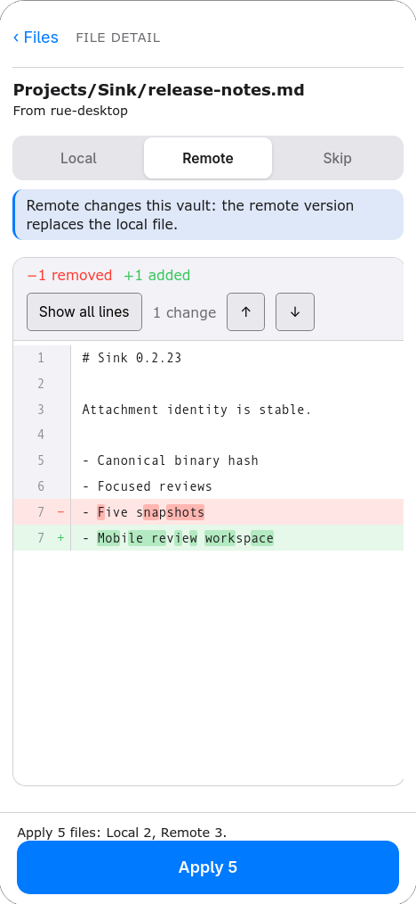
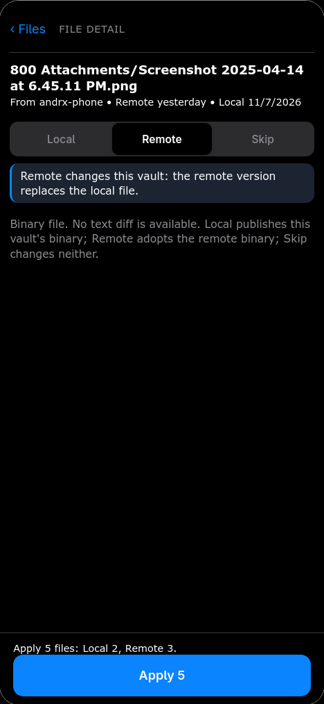
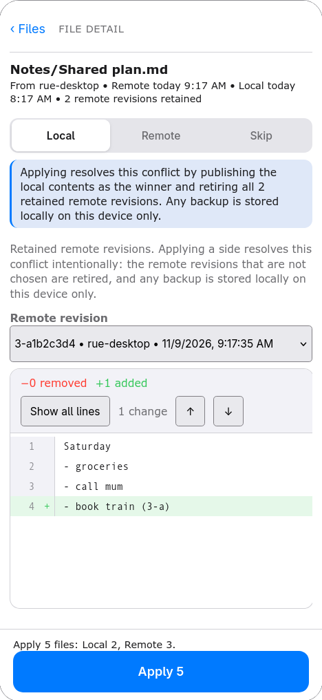

# Sink 0.2.23: mobile review workspace

Mobile UI release. Sync algorithms are unchanged from 0.2.22. Tag: `0.2.23`, without a `v` prefix.

## Mobile review workspace

On Obsidian mobile, the sync review now opens as a full-screen workspace designed for touch:

- Files appear as rounded cards instead of table rows.
- Each card has a **Local / Remote / Skip** segmented control.
- Tap anywhere on a card to open a full-screen detail view with a back button.
- The detail view uses a **unified diff** rather than two cramped side-by-side panes.
- The decision, consequence, and retained-revision picker stay visible above the diff.
- A safe-area-aware bottom bar shows the live effective count and an **Apply N** action.
- Bulk actions set every file at once: **All local**, **All remote**, **Skip all**, or **Suggested**.
- Blocked rows explain the reason and cannot be applied.
- Pagination appears only when the review has more than one page.
- Light and dark themes use Obsidian's theme variables.

Desktop keeps the existing side-by-side review. Settings and the setup wizard keep Obsidian's native mobile controls.

## Same decisions, different presentation

The mobile layout does not change review semantics:

- Local and Remote remain explicit side choices. Skip never writes.
- Divergent edits and retained CouchDB conflict revisions still require a decision.
- Remote revisions can be selected in the detail view before choosing Remote.
- Deletions still require the same confirmation.
- Apply and Cancel still resolve the complete operation.
- Desktop and mobile send the same `ReviewResult` decisions to the sync engine.

## Mockups

These are rendered from the real review component at a 390 × 844 phone viewport.

| Files | Detail |
| --- | --- |
|  |  |

| Binary file | Retained conflict |
| --- | --- |
|  |  |

## Included from 0.2.22

- Binary attachments use one canonical content identity across inline, chunked, encrypted, and plaintext storage. Unchanged attachments no longer reappear in startup reviews.
- Binary fast-forward and same-timestamp edits are detected by content, not modification time.
- A mixed startup batch shows only rows that need a decision; safe rows apply after approval.
- Physical CouchDB tombstones no longer block conflict retirement.
- Settings shows the five most recent snapshots. Older snapshots remain stored and are not deleted.

## Compatibility

Install all three assets together: `main.js`, `manifest.json`, and `styles.css`. No data migration or database rebuild is required. Obsidian mobile and desktop share the same plugin build.

Verification: 168 unit/DOM tests, typecheck/build, 11/11 full E2E, and a 390 × 844 light/dark mobile render check. See [0.2.23 verification](https://github.com/aandrx/sink/blob/0.2.23/docs/verification/0.2.23.md).
